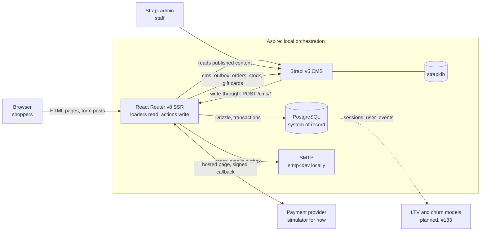

# Jassmin

**A bilingual, server-rendered online shop for a small perfume store in Ukraine.** One full-stack TypeScript app: React Router v8 SSR, PostgreSQL as the system of record and Strapi as the staff admin.

[](https://github.com/savchukolgaa/jassmin/actions/workflows/ci.yml)
[](LICENSE)

**Live demo:** coming soon.

<!-- hero: docs/screenshots/home-desktop.webp + docs/screenshots/home-phone.webp, see docs/screenshots/README.md -->
_Screenshots coming soon. They'll be taken on synthetic shop data ([#131](https://github.com/savchukolgaa/jassmin/issues/131)), never on real customer data._

**Contents:** [Features](#features) · [Architecture](#architecture) · [Tech stack](#tech-stack) · [Engineering decisions](#engineering-decisions) · [Quality](#quality) · [How it's built](#how-its-built) · [Getting started](#getting-started) · [Licence](#licence)

## Features

**For shoppers**

- Women's and men's catalogs filtered by fragrance family, a "popular" list, and product pages with notes and five sizes per perfume (5 to 100 ml).
- Cart and checkout for guests and account holders: card payment or cash on delivery, free delivery from 1500 ₴.
- Discounts that checkout really applies: promo codes, the tester trio (three 10 ml sizes for 499 ₴) and the couple offer (15% off the cheaper of two full bottles). Each order gets the single best saving.
- Gift cards of 500, 1000 and 2000 ₴, emailed as a code and spendable across several orders.
- An account with order history and status, order confirmation emails, a blog and an offers page.
- Ukrainian and English throughout, with translated URLs (`/katalog/zhinochi`, `/en/catalog/women`).
- Server-rendered, indexable pages with structured data, a sitemap and a generated share image for every product.

**For staff**

- One admin, Strapi: products, prices, orders and their statuses, editorial content and offers, in both languages. The shop checks every save and writes it through to its own database.

**For the owner**

- Privacy-aware analytics (nothing is tracked before consent) and a schema designed for LTV, churn and demand models. The analytics case study is in progress in [#133](https://github.com/savchukolgaa/jassmin/issues/133).

## Architecture



- **One server, no API layer.** Pages read in route `loader`s and write in route `action`s; forms are real HTML forms that post to actions.
- **PostgreSQL is the system of record.** Products, stock, carts, orders, payments, gift cards, discount rules, users and analytics events live there. Strapi is the screen staff use: saving a product or an order sends it to the shop, which validates it and applies it in one transaction, and Strapi stores what the shop answers.
- **Outboxes for side effects.** Order emails and the push of orders, stock and gift cards to Strapi are queued in the same transaction as the change, sent right after the commit and retried by jobs. An order never exists without its email or its Strapi copy.
- **Aspire** starts PostgreSQL, Strapi, smtp4dev, the migrations and the dev server with one command for local development.

## Tech stack

| Area | Choice |
|------|--------|
| Framework | [React Router](https://reactrouter.com) v8, framework mode, SSR (`ssr: true`) |
| Language | TypeScript 7, `strict` + `noUncheckedIndexedAccess`, no `any` |
| Styling | Tailwind CSS v4, self-hosted variable fonts |
| Database | PostgreSQL 18 via [Drizzle ORM](https://orm.drizzle.team) (`pg` driver), migrations with hand-written rollbacks |
| CMS | [Strapi](https://strapi.io) v5 (`cms/`): products, orders, gift cards (read-only), blog, home page, offers, contact details |
| Validation | zod 4 (env vars, every `action` input, CMS responses), kept out of the browser bundle |
| i18n | Own typed dictionaries (`uk` is the source of truth, `en` must match), translated URLs, hreflang |
| Email | Nodemailer, with a database outbox and retries |
| Payments | A `PaymentProvider` interface with a local signed-callback simulator |
| Share images | Generated label cards rendered to PNG with resvg |
| Auth | Cookie sessions, Argon2 password hashes |
| Lint / format | [Biome](https://biomejs.dev) |
| Tests | Vitest and Testing Library, with integration tests on a real PostgreSQL |
| Local orchestration | [Aspire](https://aspire.dev) (TypeScript AppHost) |
| Package manager | pnpm |

## Engineering decisions

- **Server-rendered, with no client data layer.** Reads in loaders and writes in actions, with no REST API, React Query or client store. Less JavaScript and fewer moving parts: pages now load 6 scripts before first paint instead of 21–28, and zod no longer reaches the browser ([#96](https://github.com/savchukolgaa/jassmin/issues/96), [PR #97](https://github.com/savchukolgaa/jassmin/pull/97)).
- **PostgreSQL stays the system of record, and Strapi writes through to it.** Staff get a real admin without one being built, while checkout still locks and changes stock in one database and a CMS outage can't change a price ([#40](https://github.com/savchukolgaa/jassmin/issues/40), [PR #63](https://github.com/savchukolgaa/jassmin/pull/63)).
- **Transactional checkout and a pure pricing engine.** Stock, the order, its items, the discount redemption, the gift card balance, the cart status and the outbox rows are written in one transaction. Prices are worked out in whole kopiyky by one pure function that the cart and checkout share, with one discount per order ([#59](https://github.com/savchukolgaa/jassmin/issues/59), [PR #62](https://github.com/savchukolgaa/jassmin/pull/62); the couple offer [#124](https://github.com/savchukolgaa/jassmin/issues/124), [PR #127](https://github.com/savchukolgaa/jassmin/pull/127); gift cards [#125](https://github.com/savchukolgaa/jassmin/issues/125), [PR #144](https://github.com/savchukolgaa/jassmin/pull/144)).
- **Outboxes instead of "send and hope".** Emails and the push to Strapi are rows written with the order, sent after the commit and retried with backoff, so a mail or CMS outage never loses or blocks an order ([#45](https://github.com/savchukolgaa/jassmin/issues/45), [#40](https://github.com/savchukolgaa/jassmin/issues/40)).
- **Language in the URL, with type-checked translations.** Every page has a Ukrainian and an English address linked by hreflang, and the two dictionaries can't drift apart: `pnpm typecheck` fails when a key is missing ([#84](https://github.com/savchukolgaa/jassmin/issues/84), [PR #93](https://github.com/savchukolgaa/jassmin/pull/93)).
- **Analytics designed for the models it will feed.** Sessions and behavioural events are recorded only after consent, and columns such as `users.acquisition_channel`, `products.fragrance_family` and `carts.abandoned_at` are kept as ML features for LTV and churn ([#5](https://github.com/savchukolgaa/jassmin/issues/5), [#18](https://github.com/savchukolgaa/jassmin/issues/18), [PR #50](https://github.com/savchukolgaa/jassmin/pull/50)).
- **SEO as a feature.** Translated metadata, schema.org data, a sitemap, Core Web Vitals work and a generated share image for every product ([#85](https://github.com/savchukolgaa/jassmin/issues/85)–[#88](https://github.com/savchukolgaa/jassmin/issues/88): PRs [#91](https://github.com/savchukolgaa/jassmin/pull/91), [#92](https://github.com/savchukolgaa/jassmin/pull/92), [#94](https://github.com/savchukolgaa/jassmin/pull/94), [#95](https://github.com/savchukolgaa/jassmin/pull/95); [#105](https://github.com/savchukolgaa/jassmin/issues/105), [PR #117](https://github.com/savchukolgaa/jassmin/pull/117)).

## Quality

- **1,768 tests in 170 files** (Vitest, November 2026), from pure pricing functions to route actions and components. The database tests run against a real PostgreSQL, each file in its own throwaway database.
- **Strict TypeScript and Biome:** `strict` with `noUncheckedIndexedAccess`, no `any` (a Biome error), `import type` enforced. `pnpm typecheck`, `pnpm lint` and `pnpm test` pass before every commit, and `pnpm build` before every merge. GitHub Actions runs all four on every pull request, with the database tests on a PostgreSQL service and a check that fails the run if any test was skipped; a PR merges only when they pass ([docs/ci.md](docs/ci.md), [#142](https://github.com/savchukolgaa/jassmin/issues/142)).
- **Lighthouse (mobile):** Performance 90 on the home page, 94 on a catalog page and 92 on a product page; SEO 100 and CLS 0 on every page measured; Accessibility 90 on the home page and 95–96 on the others. Measured locally on a production build with Lighthouse 12.6.1, median of 3 runs ([PR #97](https://github.com/savchukolgaa/jassmin/pull/97)).
- **Accessibility basics:** a visible `focus-visible` ring on every interactive element and motion that respects `prefers-reduced-motion`, defined in the design system ([docs/design.md](docs/design.md)).

## How it's built

Jassmin is built with an AI coding agent (Claude Code) working under the owner's direction and review, through a fixed workflow:

1. **Issue.** Each change starts as a GitHub issue with a user story, context and acceptance criteria (`/create-issue`).
2. **Plan.** The agent reads the issue and the code and writes a step-by-step plan, with its decisions and open questions, to `docs/plans/<n>-<slug>.md`. The owner answers the questions before any code is written (`/create-plan`).
3. **Worktree.** Each issue gets its own branch `issue/<n>` and git worktree, so several issues are worked on in parallel without touching the main checkout.
4. **Implement.** The agent works through the plan one step at a time, with tests, and commits each step once typecheck, lint and tests pass (`/implement`).
5. **Pull request.** The PR links the issue and records how the work differed from the plan. CI must be green, and the owner reviews it before merging (`/open-pr`).

The rules the agent follows are in [AGENTS.md](AGENTS.md) and the scoped [app/.server/AGENTS.md](app/.server/AGENTS.md). The skills are in [.claude/skills/](.claude/skills/), and the workflow guides they use are in [docs/skills/](docs/skills/README.md).

## Getting started

### Prerequisites

- **Node.js 24 LTS** (see `.nvmrc`)
- **pnpm 12**: `npm install -g pnpm` (the version is pinned in `package.json` → `packageManager`)
- **Docker Desktop**, running
- **PostgreSQL 18+** if you run without Aspire (the schema uses the built-in `uuidv7()`). Aspire and the Docker command in the [setup guide](docs/setup.md#without-aspire) already use `postgres:18`.
- **Aspire CLI ≥ 13.4**:
  - Windows: `irm https://aspire.dev/install.ps1 | iex`
  - macOS/Linux: `curl -sSL https://aspire.dev/install.sh | bash`
- A trusted HTTPS dev certificate: `aspire certs trust`. `aspire doctor` checks the whole setup.

### Quick start

```bash
cp .env.example .env        # then set SESSION_SECRET to a random 32+ character string
cp cms/.env.example cms/.env  # then replace every "tobemodified" secret (see docs/setup.md, "Content (Strapi CMS)")
pnpm install
pnpm aspire run             # starts PostgreSQL, Strapi and the dev server, prints the dashboard URL
```

pnpm installs with its global virtual store (`enableGlobalVirtualStore` in `pnpm-workspace.yaml`): `node_modules` is a small tree of links into one shared store inside the pnpm store (`pnpm store path`), so the main checkout and every issue worktree share one copy of each package.

Under Aspire, the `db-migrate` resource applies the database migrations on every run, before `web` starts. To load the sample products, start the `db-seed` resource from the dashboard.

Open the Aspire dashboard and click the `web` resource's endpoint. Until you've created the Strapi API token ([First-time setup](docs/setup.md#first-time-setup)), pages that need Strapi content answer with a 503 "content temporarily unavailable" page.

> Use `pnpm aspire …` rather than plain `aspire …`. Aspire installs the AppHost with `pnpm install --ignore-workspace`, and pnpm then rejects esbuild's build script. The wrapper `scripts/aspire.mjs` approves only that one build and then runs the Aspire CLI with your arguments (`run`, `start`, `stop`, `ps`, …).

### Everyday commands

| Command | What it does |
|---------|--------------|
| `pnpm dev` | Dev server with HMR, without Aspire |
| `pnpm typecheck` | Generate route types, then `tsc` |
| `pnpm lint` | Biome lint + format check (`pnpm format` fixes) |
| `pnpm test` | Vitest, run once (the database tests need a configured database) |
| `pnpm build` | Production build into `build/` |

### More in the setup guide

[docs/setup.md](docs/setup.md) has everything else:

- [Running without Aspire](docs/setup.md#without-aspire)
- [Environment variables](docs/setup.md#environment-variables) (the full table)
- [All scripts](docs/setup.md#scripts), including the `db:*` jobs
- [Strapi: setup, content model and translations](docs/setup.md#content-strapi-cms)
- [Products and orders in Strapi](docs/setup.md#products-and-orders-in-strapi)
- [Order emails](docs/setup.md#order-emails), [abandoned carts](docs/setup.md#abandoned-carts) and [gift cards](docs/setup.md#gift-cards), with their cron jobs
- [Card payments (simulator)](docs/setup.md#card-payments-simulator)
- [Database migrations](docs/setup.md#database-migrations)
- [Project structure](docs/setup.md#project-structure)
- [SEO and submitting the sitemap](docs/setup.md#seo)
- [Admin role](docs/setup.md#admin-role)

## Licence

The source is available to read and evaluate; all rights are reserved. See [LICENSE](LICENSE). The Jassmin name, logo, product texts and images belong to the shop.
