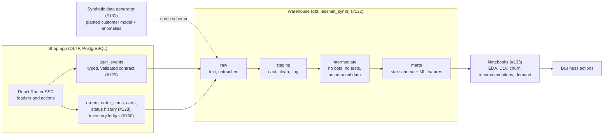
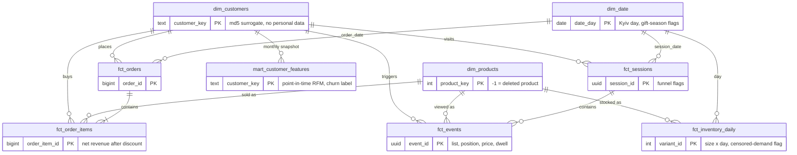
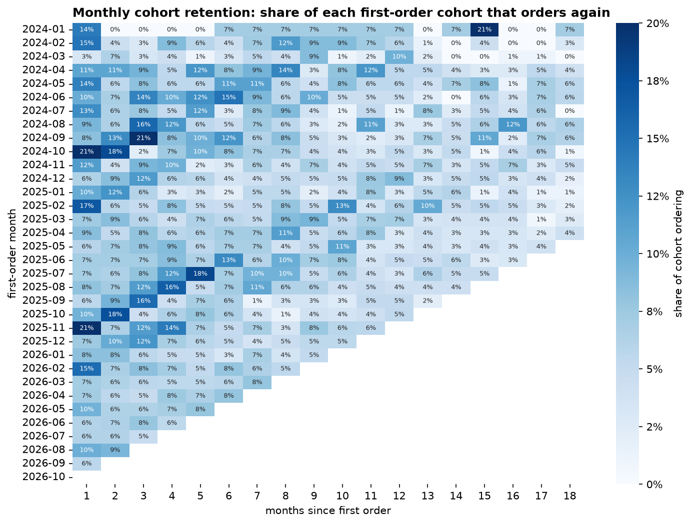
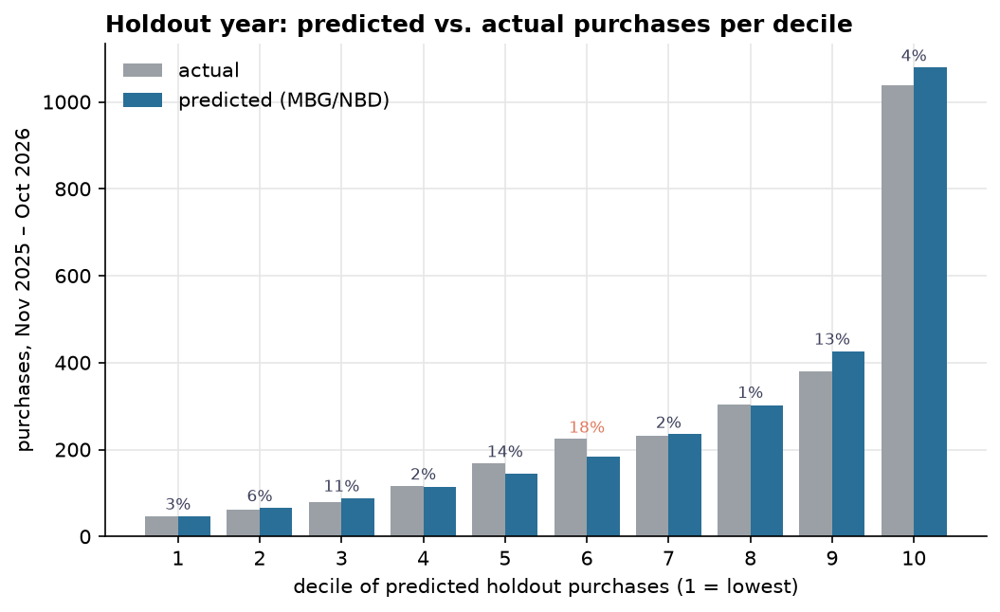
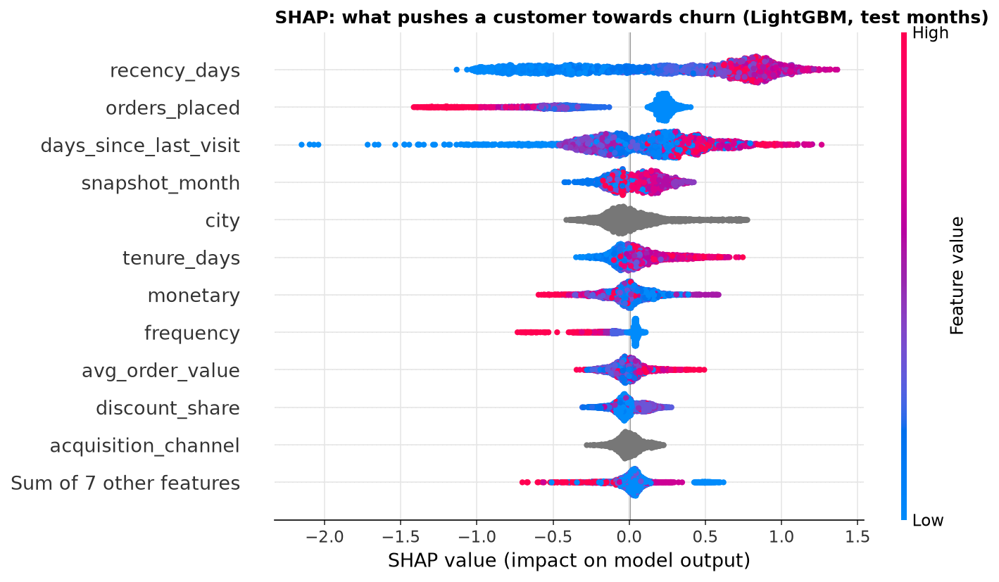
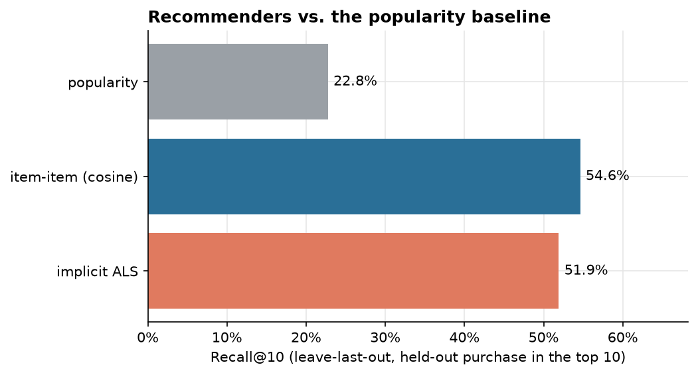
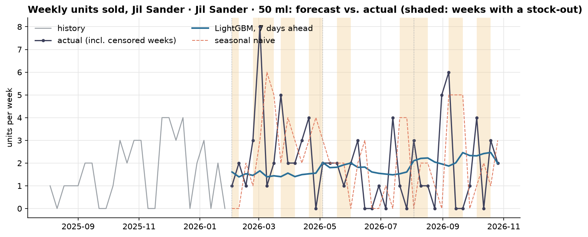

# Analytics: from event tracking to business decisions

A portfolio case study built on Jassmin, a small Ukrainian perfume shop: how the app's
event-driven behavioural tracking becomes a tested warehouse and then four models with a business
decision attached to each. Everything here runs on reproducible synthetic data, so every number in
this page can be regenerated, and the models can be checked against a known truth.

| Part | Where | Issue |
|------|-------|-------|
| Event contract and OLTP schema | `app/`, `docs/analytics-events.md` | #128, #129, #130 |
| Synthetic shop data with a planted customer model | `generator/` ([below](#the-synthetic-data-generator-131)) | #131 |
| Layered ELT warehouse with data tests (dbt) | [`warehouse/`](warehouse/README.md) | #132 |
| EDA and four models (Jupyter) | [`notebooks/`](notebooks/README.md) | #133 |

## The problem

A small online shop has the questions every retailer has, with very little data to answer them:

- **Who are our valuable customers,** and how much will they spend next year (customer lifetime
  value, CLV)?
- **Who is about to stop buying,** and is a win-back promo worth its discount (churn)?
- **What should we show each customer** next to the perfume they're looking at (recommendations)?
- **How much stock of each bottle** should we hold, when demand spikes around 8 March and December
  and the supplier takes up to three weeks (demand forecasting)?

The real shop is too new to have the history these need, so #131 simulates three years of it
(10,000 customers, about a million events) with a *known* customer model: each customer has a
segment, a purchase rate and a churn probability that the models never see. That turns the work
from "the model looks plausible" into "the model recovers the truth", and the generator also plants
a catalogue of data-quality anomalies for the warehouse to catch.

## Architecture



The **OLTP vs. analytical layer** split is strict: the app's tables serve checkout and stay
normalised; nothing analytical reads them. The warehouse is **layered (medallion) ELT**: raw data
lands untouched (every column `text`, so every anomaly survives), staging casts and cleans it, and
marts are built for questions, not transactions. The models read only `marts.*`, through a
read-only connection that refuses any database except `jassmin_synth`.

## Data model

The marts are a star schema around three dimensions, plus one wide table for the churn model:



`mart_customer_features` is **point-in-time feature engineering**: one row per customer and month,
and every feature reads only data from before the snapshot (an order returned later still counts as
a sale at the snapshot, because that's what was known then). Two dbt tests enforce it, and both were
checked to fail when a feature peeks 30 days ahead.

## Data quality: from anomaly catalogue to tests

The app's analytics events follow a typed **data contract** (#129): every event type has a zod
schema, and the generator's events are checked against the same schemas in the app's test suite.
Downstream, the generator plants 12 kinds of anomaly, and the warehouse must find each one, clean or
flag it, and prove it with a **data test**. A selection (all 12 are in the [warehouse
README](warehouse/README.md#anomaly-handling)):

| Planted anomaly | Found | Handling in staging | Data test |
|-----------------|-------|---------------------|-----------|
| Double-fired events | 1.50 % extra rows | dropped (same session, type, product, properties within 1 s) | `assert_no_double_fired_events` |
| Bot sessions | 25 | flagged by view rate, excluded downstream | `assert_no_bot_sessions_in_marts` |
| Price typo (× 10 total) | 0.20 % of orders | recomputed from the lines, raw value kept | `assert_order_totals_reconcile` |
| Shipped after completion | 0.41 % | fixed from the status history | `assert_order_timeline_consistent` |
| Deleted product on a line | 0.50 % of lines | recovered from the size, else unknown member `-1` | `relationships` to `dim_products` |
| Backorders (negative stock) | 684 movements | kept; stock floored at 0, day marked as censored demand | `assert_ledger_sums_to_stock` |
| Test accounts, messy emails, naive timestamps, lowercase currency, missing phone or device | as planted | excluded, normalised or flagged | `accepted_values`, `unique`, custom tests |

A full build runs 29 models and 150 data tests. The models then inherit clean inputs: no bots
inflating views, no ×10 orders inflating CLV, and stock-outs marked so the demand forecast can
treat them as **censored demand**.

## Results

All five notebooks run top to bottom from a clean `uv sync` in about two minutes, with fixed seeds;
two runs give byte-identical outputs. Each ends with a cell that asserts its own success criteria.
Numbers are for the generator's default run (seed 42).

### 1. Exploration ([`01_eda_rfm_cohorts`](notebooks/01_eda_rfm_cohorts.ipynb))

RFM segments, cohort retention, an STL seasonality decomposition and the session funnel. Champions
(20 % of customers) bring 41 % of revenue. About 8 % of a cohort orders again in any of its first six
months. December, February and March lead the seasonality. The funnel is the same on every device
and channel (about 71 % of carts become orders), so differences in customer value come from repeat
behaviour, not from the first visit.



### 2. Probabilistic CLV ([`02_ltv_bgnbd_gg`](notebooks/02_ltv_bgnbd_gg.ipynb))

**Probabilistic CLV** with the BG/NBD family plus Gamma-Gamma, fitted on purchases before November
2025 and checked on the following 12 months. Two choices made it work, both derived from how the
shop behaves rather than from the holdout:

- **A seasonally adjusted clock.** On calendar weeks BG/NBD missed the holdout year by −15 % (the
  calibration period ended after a slow summer; ending it in April instead gives +30 %). Measuring
  time in expected-demand weeks, from a Poisson GLM of the repeat-purchase rate, removes the bias.
- **MBG/NBD**, which allows a customer to leave after their *first* order. Classic BG/NBD keeps
  every one-time buyer alive forever.

| Model | Holdout total | Deciles within 15 % | Worst decile |
|-------|---------------|---------------------|--------------|
| BG/NBD, calendar clock | −15.4 % | 6 / 10 | 31 % |
| BG/NBD, seasonal clock | +3.5 % | 6 / 10 | 41 % |
| **MBG/NBD, seasonal clock** | **+1.3 %** | **9 / 10** | **18 %** |



Against the ground truth, the model recovers the segment order: recovered purchase rates of 5.0 /
3.0 / 2.1 / 1.8 orders a year against 6.3 / 3.1 / 1.4 / 0.6 for the loyal, regular, occasional and
one-time segments, shrunk towards the mean as a Bayesian model should. Spearman ρ with the true rate
is 0.46, P(alive) has a ROC-AUC of 0.74 for "still active", and four clusters on the model's outputs
match the planted segments well above chance (ARI 0.14 against 0.004 for shuffled labels; 45 %
matched accuracy against 35 %). One-time and occasional buyers stay mixed: with a single order there
is nothing to tell them apart.

**Business action.** Existing customers are worth about 4.4 million ₴ over the next 12 months, and
the top 10 % of them hold 46 % of it. Mean CLV barely differs between acquisition channels, so the
acquisition budget should follow each channel's volume × CLV, and retention effort should go to the
top CLV decile ranked by the model (which discounts big spenders who have gone quiet), not by past
spend.

### 3. Churn ([`03_churn`](notebooks/03_churn.ipynb))

Will a customer place no order in the next 90 days? Trained on the point-in-time monthly snapshots,
with a time-based split (train to August 2025, tune September–December, test January–August 2026).

| Test, Jan–Aug 2026 | ROC-AUC | PR-AUC (churn) | PR-AUC (retained) | Brier |
|--------------------|---------|----------------|-------------------|-------|
| Base rate | 0.500 | 0.871 | 0.129 | 0.112 |
| Logistic regression | 0.786 | 0.957 | 0.405 | 0.094 |
| **LightGBM** | **0.807** | **0.961** | **0.427** | **0.092** |

With 87 % of customer-months churning, the retained-class PR-AUC is the informative one. A
bootstrap over customers puts LightGBM ahead in all 300 resamples. Both models are already well
**calibrated** (reliability curves on the diagonal, and isotonic recalibration doesn't lower the
Brier score), so the probabilities can be used as probabilities.



SHAP shows recency rising steeply to about 300 days and then flattening, purchase history
protecting, and a recent visit pulling risk down. It also gives `city` a wide spread although the
generator plants no city effect: dropping it doesn't change validation PR-AUC. A high SHAP value is
not proof that a feature matters.

**Business action.** A 15 %-off win-back promo for the top decile: ranking by expected net gain
(risk × order value × uplift, minus the discount given to customers who would have ordered anyway)
instead of by risk alone picks customers with twice the order value, and about 89,000 ₴ of
expected net gain against 49,000 ₴ at an assumed 10 % uplift. The uplift is an assumption, so the
promo should run as an A/B test on this list.

### 4. Recommendations ([`04_recommendations`](notebooks/04_recommendations.ipynb))

Implicit feedback (views, dwell, cart adds, purchases), evaluated leave-last-out. Each customer's
last purchased perfume is hidden, with everything from the visit that led to it.

| Model | Recall@10 | NDCG@10 | Catalogue coverage |
|-------|-----------|---------|--------------------|
| Popularity | 22.8 % | 0.103 | 8 % |
| **Item-item cosine** (co-views, co-purchases) | **54.6 %** | **0.335** | **100 %** |
| Implicit ALS (tuned on a validation fold) | 51.9 % | 0.292 | 72 % |



Both personalised models put almost three times as many perfumes from the customer's (hidden) true
favourite family in the top 10 as popularity does: they learned the planted taste from behaviour.
On position bias, the data shows two traps. Impressions are logged only for the cards on screen, so
deeper positions look like 100 % click-through. In the popularity-sorted lists, position and appeal
are confounded. Clicks shouldn't train a ranker until the shop logs full-list impressions and
randomises its top slots.

**Business action.** Ship the item-item model: it is the most accurate and a 128 × 128 similarity
table is trivial to serve. Customers who bought several perfumes in one order (the tester trio)
are cold-start and need the popularity or in-cart fallback.

### 5. Demand forecasting ([`05_demand_forecast`](notebooks/05_demand_forecast.ipynb))

Daily units per full bottle (384 sizes), with stock-out days treated as **censored demand**: masked
from training, evaluation and lag features. The day a size sells out always has a sale, so they
aren't zeros either. Without masking the forecast drifts +6 %; with it, −1 %. LightGBM with calendar
features against a seasonal-naive baseline, 7 days ahead, over three 13-week rolling origins:

| WAPE (lower is better) | Seasonal naive | LightGBM |
|------------------------|----------------|----------|
| Per size and week (the decision horizon) | 1.38 | **1.21** |
| Daily units per bottle size class | 0.54 | **0.37** |
| Daily units, whole shop | 0.38 | **0.23** |
| Per size and day | 1.82 | 1.81 |

A single bottle sells on 4 % of days, and WAPE rewards the median, so per size and day "always 0"
(1.0) beats any honest rate forecast. That row is reported, but WAPE is only used where it can rank
forecasts. There LightGBM wins in every origin, and on all of the 20 best-selling sizes.



**Business action.** With a 5–21 day supplier lead time, the best sellers need a reorder point of
8–14 units for a 95 % service level, not the current "reorder at 1". The last 13 weeks show why:
those sizes were out of stock on 42–62 of 91 days.

## Limitations, and what changes with real data

- **The data is synthetic.** The generator's customer model is close to the models' own assumptions:
  churn after each order is exactly MBG/NBD's dropout process, and purchases are Poisson. Real
  customers will fit worse, so the ground-truth checks show the *pipeline* is right, not that these
  models are right for the real shop.
- **Short history.** Three years of data and two observations of most calendar weeks. The seasonal
  index (notebook 02) and the 8 March response (notebook 05, which under-reacts at the size level)
  would both improve with more years, or with a top-down forecast of the shop's total split by size.
- **Assumed economics.** The win-back uplift, the promo cost and the discount rate are assumptions.
  Real decisions need an A/B test, and later an uplift model that targets *persuadable* customers.
- **Offline only.** Nothing is served yet. Serving the recommendations on the site, scoring churn
  monthly and feeding reorder points to the Strapi admin would be follow-up issues.
- **With real data** the same marts should work unchanged: the dbt `prod` target is defined to read
  the app's tables (not run yet). The first steps would be to rerun the anomaly profiling, expect new anomaly types, retrain on a
  rolling window, and monitor calibration and data drift.

## Running it

```bash
uv run analytics/generator/generate.py --customers 10000               # synthetic data (#131)
uv run --project analytics/warehouse analytics/warehouse/wh.py build   # warehouse + data tests (#132)
uv run --project analytics/notebooks analytics/notebooks/run_all.py    # the five notebooks (#133)
```

See [`notebooks/README.md`](notebooks/README.md) for JupyterLab and the tests.

---

## The synthetic data generator (#131)

The real shop is new, so there's too little history for LTV, churn or demand forecasting. The
generator in `generator/` (#131) simulates about three years of this shop: about 10,000
customers with a known behaviour model and 15,000 anonymous visitors. It produces their visits
and #129 analytics events, carts, orders, payments, discounts, status history and inventory, and
loads them into a separate `jassmin_synth` database. The ETL (#132) and ML (#133) work runs on it.

The data looks like this shop rather than generic e-commerce:

- the real catalog (`app/.server/db/catalog-data.ts`, 128 perfumes) and price table (5 ml 119 ₴,
  10 ml 240 ₴, 30 ml 459 ₴, 50 ml 629 ₴, 100 ml 969 ₴);
- the shop's discount rules, priced by a port of the app's own pricing: the tester trio (3 × 10 ml
  for 499 ₴, #59), the couple offer (15 % off every second full bottle, #124), the welcome code
  `JASSMIN10`, and a yearly 8 March code `VESNA<year>`. Free delivery starts at 1500 ₴ after the
  discount (#71);
- Ukrainian seasonality: 8 March, 14 February, St Nicholas Day, New Year, Black Friday, and a
  summer dip;
- card payments (with failed attempts) or cash on delivery, and Nova Poshta parcels that are
  never collected (`unclaimed`);
- traffic mostly from Instagram and Telegram, and mostly on phones.

## Running it

You need [uv](https://docs.astral.sh/uv/) (`winget install --id=astral-sh.uv -e`) and the repo's
`pnpm install`, because the app's migrations are applied with `pnpm db:migrate`.

```bash
# From the repo root. The server is SYNTH_DATABASE_URL, else DATABASE_URL in .env.
uv run analytics/generator/generate.py --customers 10000

# Also fill the app's own tables in jassmin_synth, so the app can run on the synthetic data.
uv run analytics/generator/generate.py --customers 10000 --load-app-schema

# Only the CSV files (one per table), no database.
uv run analytics/generator/generate.py --customers 300 --out analytics/out --no-db
```

Under Aspire, start **`synth-generate`** from the dashboard (child of `jassmin-synth`). It runs
the same command with `--load-app-schema` against the Aspire Postgres server, whose password only
Aspire knows.

| Argument | Default | Meaning |
|----------|---------|---------|
| `--customers` | 10000 | Registered customers. |
| `--visitors` | 15000 | Anonymous visitors who never register. About 2 % of them place a guest order. |
| `--start` / `--end` | 2024-01-01 / 2026-11-01 | The simulated period (Kyiv days, end exclusive). |
| `--seed` | 42 | The same seed gives byte-identical data. |
| `--load-app-schema` | off | Also load `public.*` (see below). |
| `--out DIR` | — | Also write one CSV per table. |
| `--no-db` | off | Don't connect to any database. |
| `--database-name` | `jassmin_synth` | `jassmin_synth` or `jassmin_synth_<suffix>` only (used by the tests). |

A full run (10,000 customers) takes about 40 s to generate and one to two minutes to migrate and load.
With seed 42 it produces:

| Table | Rows |
|-------|------|
| users | 10,015 |
| sessions | 67,387 |
| user_events | 1,019,447 |
| carts / cart_items | 25,108 / 48,709 |
| orders / order_items | 18,067 / 35,498 |
| payments | 10,222 |
| order_status_history | 63,078 |
| inventory_movements | 19,717 |

### Safety

The generator **never writes to the app's database**. The database name is always replaced by
`jassmin_synth` (or `--database-name`). It must match `jassmin_synth[_suffix]`, and it must not be
the database of `JASSMINDB_URI` or `DATABASE_URL`. Any other target exits with an error before
anything connects. A missing database is created. Every run then applies the app's migrations
and replaces the data: the `raw` schema is dropped and recreated, and with `--load-app-schema` the
app tables are truncated first.

## What's in the database

**`raw.*`** is the landing zone for #132. It has one table per app table with the app's column
names, plus `raw.customer_truth` and `raw.generation_runs`. There are no keys or constraints, and
**every column is `text`**, so every anomaly survives exactly as written (naive timestamps, `uah`,
padded emails) and the staging models do all the casting. Timestamps are ISO 8601 in UTC
(`2025-03-07T18:42:10.123+00:00`), money is a decimal string, arrays are PostgreSQL array literals.

| Table | Content |
|-------|---------|
| `raw.users`, `raw.sessions`, `raw.user_events` | Customers, visits and the #129 event stream (`event_properties` follows `docs/analytics-events.md`). |
| `raw.carts`, `raw.cart_items` | Carts: `converted`, `abandoned` (after 24 h, with #139 reminders for opted-in users) or `active`. |
| `raw.orders`, `raw.order_items`, `raw.payments`, `raw.order_status_history` | Orders with the full lifecycle, `discount_allocated` per line, card payment attempts (`simulator` provider) and every status change with its source. |
| `raw.discounts` | The rules, with their `redemption_count`. |
| `raw.products`, `raw.product_variants` | The real catalog; 30/50/100 ml sizes track stock, 5/10 ml don't. |
| `raw.inventory_movements` | The stock ledger: opening balance, sales, supplier receipts, units back from cancellations, returns and unclaimed parcels. |
| `raw.customer_truth` | The ground truth per customer (below). **Evaluate models against it, never train on it.** It is never copied to `users`. |
| `raw.generation_runs` | Seed, arguments, git commit, digest and row counts of the run. |

**`public.*`** is only filled with `--load-app-schema`. It holds the raw rows that pass the app's
own constraints, so the app can run on the synthetic data. The filter reads them from the
database: values valid for the column types, NOT NULL, CHECKs, foreign keys, and unique indexes.
Anomalies that the schema allows (padded emails, test accounts, `uah`, ×10 totals, double-fired
events, bots) stay in. Two tables are exceptions. `public.inventory_movements` and
`product_variants.stock_quantity` come from a clean ledger in which each backorder shortfall is
covered by an `adjustment` row (note `synthetic backorder`), so `stock_after >= 0` and
`sum(quantity_delta) = stock_quantity` hold, and so does the `inventory_daily` view. Every
synthetic user can log in with the password **`jassmin-demo`**.

## The customer model (ground truth)

Each customer has a segment, an individual purchase rate, a churn probability, a favourite
fragrance family, a usual device, a city and an acquisition channel. `raw.customer_truth` stores
them, with `churned_at` (the order after which the customer churned; `null` if still alive at the
end).

| Segment | Share | Mean orders / year while alive | Churn probability after each order |
|---------|-------|--------------------------------|-------------------------------------|
| `loyal` | 8 % | 6.0 | 0.06 |
| `regular` | 22 % | 3.0 | 0.18 |
| `occasional` | 35 % | 1.3 | 0.40 |
| `one_time` | 35 % | 0.6 | 0.85 |

- **Purchases** follow a Poisson process (BG/NBD-style). Each customer's rate is drawn from a
  Gamma distribution (shape 2) around their segment's mean, and scaled by the day's seasonality.
  After every order the customer churns with the segment's probability. 70 % order in the visit
  they sign up in.
- **Browsing:** 0–3 visits before each order, 35 % of them leaving a cart (most get abandoned).
  Some visits come before signup with the same anonymous id, which is the first touch. Churned
  customers still come back about 1.5 times without buying.
- **Taste:** 65 % of a customer's product views are in their favourite family; the rest follow
  overall popularity, which favours the `/popular` list.
- **Signups** grow over time (a Beta(1.6, 1) trend) with the same seasonality.
- **Traffic and devices:** Instagram 34 %, Google 22 %, direct 16 %, Telegram 12 %, referral 9 %,
  Facebook 7 % (paid, with a campaign). Phones dominate, most of all for Instagram and Telegram,
  and 85 % of visits use the customer's usual device. Card payment is more likely on a desktop
  (62 %) than on a phone (52 %).
- **Seasonality** (multiplier on demand): January 0.8, February 1.15 (× 1.9 on 7–14 February),
  March 1.25 (× 2.6 on 1–8 March), April and May 0.95, June 0.85, July 0.75, August 0.85,
  November 1.15 (× 1.7 in Black Friday week, 22–30 November), December 1.6 (× 1.8 on 1–6 December
  and × 1.5 on 15–31 December).
- **Lifecycle:** 3 % of orders are cancelled by staff. 8 % of first card payments fail, and 40 % of
  those orders are never paid and get cancelled with `payment_failed` by the job after 48 h.
  Parcels ship after about a day (slower in December), arrive about a day later, and 7 % of
  cash-on-delivery parcels (1 % of card ones) are never collected and come back as `unclaimed`.
  2 % of completed orders are returned.
- **Inventory:** each tracked size opens with 2–8 units (6–12 for popular perfumes). At 1 unit or
  fewer a supplier order of 3–8 units (plus any backorder) arrives in 5–21 days. A shopper who
  finds a size out of stock usually takes 10 ml instead; 15 % order it anyway (a backorder).

Every parameter lives in `generator/config.py`.

## Anomaly catalogue

These anomalies are deliberate, for #132 to detect and clean. They exist only in `raw.*` (and in
`public.*` where the app's schema allows them). Rates are exact counts, `round(rate × rows)`, except
backorders, which happen per shopper with a probability.

| Anomaly | Where | Rate | How to detect |
|---------|-------|------|---------------|
| Missing device type | `sessions.device_type`, `user_events.device_type` | 3 % of each | `device_type is null` |
| Double-fired events | `user_events` | 1.5 % extra rows | same `session_id`, `event_type`, `created_at` and `event_properties`, another `event_id` |
| Bot sessions | `sessions` + `user_events` | 25 sessions of 150–399 product views, 0.7 s apart | `count(*) > 100` product views per session, or views per minute |
| Timezone-naive timestamps | `user_events.created_at` | 1 % | `created_at !~ '[+-]\d\d:\d\d$'` (the value is UTC) |
| Missing phone | `users.phone` | 12 % | `phone is null` (the orders still carry `guest_phone`) |
| Messy emails | `users.email` | 2 % | `email <> lower(trim(email))` |
| Test accounts | `users` | 15 extra users | `email like '%@example.com'`, `full_name = 'Test Test'`, no orders |
| Price typo (extra zero) | `orders.total_amount` | 0.2 % | `subtotal - discount_amount <> total_amount` (it's × 10) |
| Shipped after completion | `orders.shipped_at` | 0.4 % of completed orders | `shipped_at > completed_at` |
| Lowercase currency | `orders.currency` | 1 % | `currency <> 'UAH'` |
| Deleted product on a line | `order_items.product_id` | 0.5 % | `product_id is null` (`variant_id` and `volume_ml` remain) |
| Backorders: negative stock | `inventory_movements.stock_after`, `product_variants.stock_quantity` | ~15 % of adds of an out-of-stock size | `stock_after::int < 0` |

## Sanity checks in SQL

```sql
-- Seasonality: orders per day, 1–8 March against July.
select extract(month from created_at::timestamptz at time zone 'Europe/Kyiv') as month,
       count(*) from raw.orders group by 1 order by 1;

-- Abandoned carts.
select status, count(*) from raw.carts group by 1;

-- Stock-outs.
select count(*) from raw.inventory_movements where stock_after::int <= 0;
select count(*) from public.inventory_daily where was_out_of_stock;  -- with --load-app-schema

-- Unclaimed parcels, by payment method.
select status, payment_method, count(*) from raw.orders group by 1, 2 order by 3 desc;
```

## Development

```bash
uv run --project analytics pytest analytics          # needs SYNTH_TEST_DATABASE_URL or DATABASE_URL for the load tests
uv run --project analytics analytics/generator/fixtures.py   # after changing the simulation or the pricing
pnpm analytics:export-catalog                        # after changing the catalog or the prices
```

- `generate.py` lists its dependencies inline (PEP 723), so `uv run` works from the repo root.
  Keep them equal to `pyproject.toml`; a test checks.
- `fixtures/` is checked by the app's Vitest suite
  (`app/.server/synthetic-data.contract.test.ts`): generated events against the #129 schemas, and
  the pricing port against the app's `priceCart`.
- Determinism: every random stream is derived from `--seed`, ids are serial counters or seeded
  UUIDs (v7 for sessions and events, like the app's `uuidv7()`), money is integer kopiyky, and
  rows are written sorted by primary key.
